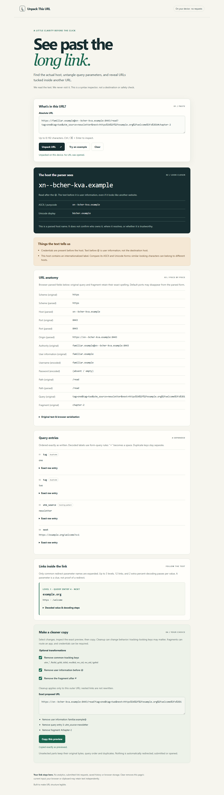

# Unpack This URL


A browser-local URL anatomy inspector. Paste an absolute URL to see its parsed host,
raw components, duplicate query entries, Unicode/punycode host forms and bounded
HTTP(S) links nested in common redirect parameters. Optional cleanup shows exact
transformations before an explicit copy action. Submitted URLs are never visited,
fetched or persisted. Syntax observations are not destination or safety judgments.

No dependencies, accounts or build tools are required. Serve `dist/` statically:

```powershell
npm test
npm run build
npm run dev
```

Local entry: http://127.0.0.1:43218. Stop the retained Node server with Ctrl+C.
`dist/` is the complete static hosting artifact; no server processing is needed.

Bounds: 8,192 input characters; first 150 query entries expanded; cleanup disabled
beyond that limit; 3 nested levels, 12 nested links total, and 2 additional percent
decoding passes per already form-decoded parameter. Only common redirect keys are
examined. Deeper or unrelated fields can still contain URLs. Native WHATWG URL
parsing and raw text are shown separately, because normalization changes spelling.

Tracking cleanup removes only `utm_*`, fbclid, gclid, dclid, msclkid, mc_cid, mc_eid,
igshid on the outer query, preserving other raw entries and their order/duplicates.
It can change URL behavior. Credentials and fragments require separate explicit
choices. Clipboard access requires a secure context; if denied, the preview is
selected for manual copy. Clear empties the current page; browser/clipboard state
is outside the app. No URL-derived hyperlinks, storage, analytics, fonts, images,
remote scripts, network APIs or automatic navigation are used. CSP blocks network
connections; all rendering uses text nodes and textarea values.

No production hosting or independent browser acceptance is implied by core tests.

## Source and verification



MIT licensed; see [LICENSE](LICENSE) and [third-party inventory](THIRD_PARTY_NOTICES.md).
Built by [Arcdrake](https://arcdrake.com/). The source is available in this repository; production hosting is being prepared.
See [verification](docs/VERIFICATION.md) and [deployment](docs/DEPLOYMENT.md). This source candidate does not establish a public deployment.

Requires Node.js 22+ for the local preview and core tests. No install is needed.
`npm test` runs deterministic core tests. `npm run package` requires Python 3.11+
and creates a checked static ZIP plus SHA-256 manifest in `artifacts/release/`.
There is no frontend compilation step; `dist/` is the application source.

For browser regression checks, follow the locked development setup below and run `npm run test:ci`. The script starts/stops its own preview and headless browser. Screenshots go to ignored `artifacts/readiness/`; only `UPDATE_SCREENSHOTS=1` replaces release images in `docs/`. Do not run it while
another process owns the app's preview port. No package/browser installation is
required for normal use. Chromium desktop and 390px emulation are recorded;
physical devices, screen readers and other engines are not newly verified.

For contributions, supply a reproducible issue with synthetic inputs only; never
attach real credentials or private URLs/domains. Run the relevant core/browser
checks with a proposed fix. [Report an issue](https://github.com/ArcdrakeStudios/unpack-this-url/issues).

## Source, support and development

[Source](https://github.com/ArcdrakeStudios/unpack-this-url) · [Issues](https://github.com/ArcdrakeStudios/unpack-this-url/issues) · [Contributing](CONTRIBUTING.md) · [Security](SECURITY.md)

Part of Arcdrake's tools collection. The planned shared home is `tools.arcdrake.com`;
production hosting is not live as part of this source release. Local use is available
above. Development checks use Node.js 24, Python 3 and locked Playwright tooling:

```sh
npm ci
npx playwright install chromium
npm test
npm run test:ci
npm run package:release
```

The CI wrapper starts and stops its own preview server. Runtime operation needs no
package installation. [Release procedure](docs/RELEASING.md).
